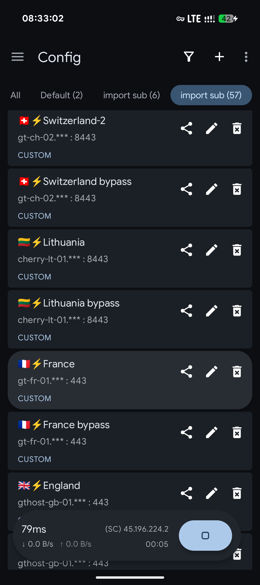
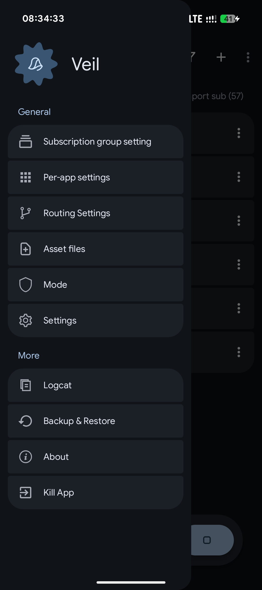
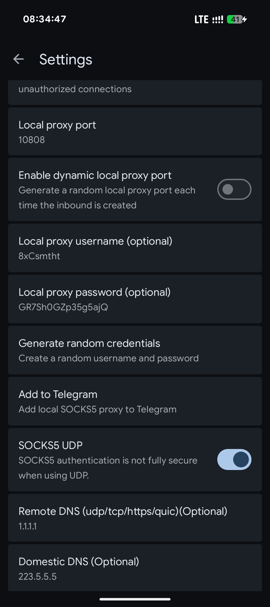

### Veil

**Xray client for Android** — with Material 3, AmneziaWG, olcRTC and OpenFlux.

 

  
  
  

  <a href="https://github.com/venterum/veil/releases"><b>Download APK</b></a>
  &nbsp;&middot;&nbsp;
  <a href="https://apps.obtainium.imranr.dev/redirect.html?r=obtainium://add/https://github.com/venterum/veil">Obtainium</a>
  &nbsp;&middot;&nbsp;
  <a href="#screenshots">Screenshots</a>
  &nbsp;&middot;&nbsp;
  <a href="#documentation">Documentation</a>
  &nbsp;&middot;&nbsp;
  <a href="README.ru.md">Русский</a>

---

> **Veil 1.0.0 is out** — the first stable release, with AmneziaWG profiles, a Compose main screen and an AMOLED theme. See the [releases](https://github.com/venterum/veil/releases) · [report an issue](https://github.com/venterum/veil/issues).

An open-source Xray client for Android. Supports the standard Xray protocols, **AmneziaWG**, **olcRTC** and **OpenFlux**. Config-compatible with [v2rayNG](https://github.com/2dust/v2rayNG).

## Screenshots

  <kbd>
    
     
  </kbd>
  &nbsp;&nbsp;
  <kbd>
    
     
  </kbd>
  &nbsp;&nbsp;
  <kbd>
    
     
  </kbd>

## Features

- **Protocols** — VMess, VLESS, Shadowsocks, Trojan, SOCKS, HTTP, WireGuard and Hysteria2, plus three tunnelled profile types: AmneziaWG, olcRTC and OpenFlux.
- **AmneziaWG** — AWG 1.5–3.x obfuscation, import from `.conf` / `amneziawg://` / `vpn://`, and a native `amneziawg-go` device over a gVisor netstack (primary profile only for now).
- **olcRTC** — Jitsi / Telemost / WbStream carriers; DataChannel / VP8 / SEI transports.
- **OpenFlux** — Yandex Docs / Volga / Board / MAX / Cups.online / Mail.ru / Avito transports through the upstream OpenFlux mobile bridge; requires a self-hosted exit node.
- **Modes** — VPN (TUN), proxy-only (SOCKS5), hybrid (SOCKS5 with an in-app TUN toggle) and root.
- **Proxy chains** — route a connection through several servers in order.
- **Routing** — one-tap presets (bypass RU / CN / IR), ad and tracker blocking, per-app proxy, custom rules, GeoIP / Geosite asset downloads.
- **Subscriptions** — URL import with custom HTTP headers and HWID, per-subscription update and ping.
- **Import / export** — QR codes, clipboard, files, share links, `v2rayng://install-sub`, backup and restore.
- **Interface** — Material 3 Expressive, AMOLED theme, nine languages, home-screen widget. No analytics or telemetry.

## Install

Android 8.0 (API 26) or newer.

| APK | For |
|---|---|
| `veil_*_arm64-v8a.apk` | Most modern phones — **recommended** |
| `veil_*_armeabi-v7a.apk` | Older 32-bit devices |
| `veil_*_x86_64.apk` | x86_64 emulators |
| `veil_*_x86.apk` | x86 emulators |
| `veil_*_universal.apk` | Any device; larger download |

Download from [Releases](https://github.com/venterum/veil/releases). For automatic updates, add the repository to [Obtainium](https://apps.obtainium.imranr.dev/redirect.html?r=obtainium://add/https://github.com/venterum/veil); Veil also checks GitHub for new versions itself (About → Update).

## Documentation

| Topic | EN | RU |
|---|---|---|
| Architecture | [architecture.md](docs/en/architecture.md) | [architecture.md](docs/ru/architecture.md) |
| Building | [build.md](docs/en/build.md) | [build.md](docs/ru/build.md) |
| olcRTC | [olcrtc.md](docs/en/olcrtc.md) | [olcrtc.md](docs/ru/olcrtc.md) |
| AmneziaWG | [amneziawg.md](docs/en/amneziawg.md) | [amneziawg.md](docs/ru/amneziawg.md) |

All docs: [docs](docs/index.md).

## Building from source

See [Building](docs/en/build.md) — JDK 17+, Android SDK 37, NDK, Go 1.27 and gomobile. The release AAR is a custom build that bundles Xray, olcRTC, OpenFlux and AmneziaWG; the stock upstream AAR does not include them.

## Support the project

If you find Veil useful, you can support development with USDT:

| Network              | Address                                      |
|----------------------|----------------------------------------------|
| **Tron** (TRC-20)            | `TSv3rM2MS7Q9Nyrc1JR43y4xRjDrZmWDSU`         |
| **BNB Smart Chain** (BEP-20) | `0x2dfCb2fd70Dd8d03D1c831CC4635Edcb9De80F45` |

Thank you ❤️

## Legal

For lawful use only. You are responsible for complying with the laws of your jurisdiction and for the servers you choose to use. The author does not endorse or encourage illegal activity.

## Credits

| Project | Role |
|---|---|
| [Xray-core](https://github.com/XTLS/Xray-core) / [v2ray-core](https://github.com/v2fly/v2ray-core) | Core engine |
| [hev-socks5-tunnel](https://github.com/heiher/hev-socks5-tunnel) | TUN → SOCKS5 |
| [olcRTC](https://github.com/openlibrecommunity/olcrtc) | WebRTC transport |
| [OpenFlux](https://github.com/p1neappleXpress/OpenFlux) | Pluggable-transport tunnel |
| [amneziawg-go](https://github.com/amnezia-vpn/amneziawg-go) | AmneziaWG device |
| [gVisor](https://gvisor.dev) | Userspace network stack |
| [v2rayNG](https://github.com/2dust/v2rayNG) | Upstream base |
| [Google Sans](https://fonts.google.com/specimen/Google+Sans) | Typeface (SIL OFL 1.1) |

## License

[GNU General Public License v3.0](LICENSE).
